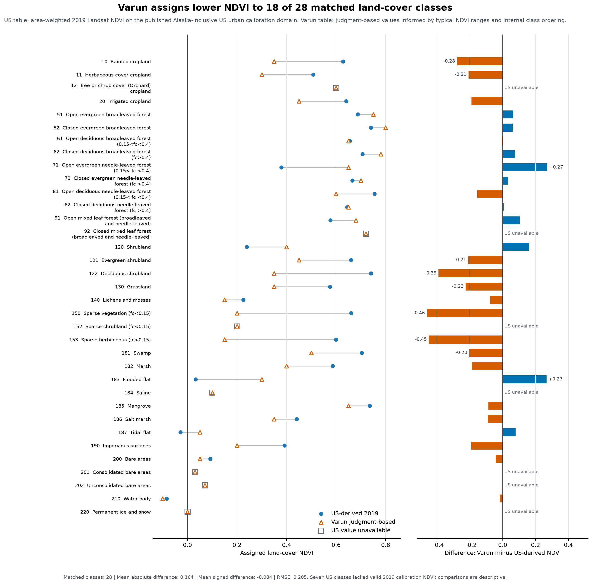

# Urban mental health data sources and preprocessing

Last updated: 27 October 2026 (organization and navigation; input review dated 21 October). The active scope is now **48 contiguous states plus DC**, excluding Alaska, Hawaii and territories.
Existing published results and source audits below describe the historical Alaska-inclusive scope.
New boundary derivatives are `processed/guppd_us_contiguous.gpkg` and
`processed/varun_us_contiguous.gpkg`; selection and excluded IDs are recorded in
`manifests/contiguous_us_scope_2026-10-27.json`. New national totals are pending.

## Data folder structure

The repository root is `gep-global/`. The active US data and the small,
version-controlled model inputs are organized as follows:

```text
data/
├── raw/                              unchanged downloads and collaborator files
│   ├── glc_fcs30d/                   annual land-cover source tiles
│   ├── worldpop/                     2019 population raster
│   ├── guppd/                        original urban-boundary package
│   ├── ghs_smod/                     2020 settlement-mask comparison crops
│   ├── cost_conversion/              exchange-rate and price-index sources
│   └── collaborator/varun_2026-10/
│       └── glc_fcs30d_attribute_table_processed_updated.csv  Varun lookup
├── processed/                        prepared model inputs
│   ├── ndvi_lookup/
│   │   └── glc_fcs30d_attribute_table_us_2019.csv            US-derived lookup
│   ├── lulc_2019_us/                 one-band 2019 land-cover tiles
│   └── ...                           prevalence, costs and selected boundaries
├── manifests/                        source, processing, checksum and QA records
├── outputs/                          retained local comparison runs
└── archive/                          historical working-data bundle
```

The US-derived lookup is a small, Git-tracked input in `data/processed/ndvi_lookup/`.
All other local data remain ignored by Git. Varun's supplied lookup stays in
`data/raw/` with its original file unchanged. Select one lookup per class-based
run and record its path and checksum. Both tables remain sensitivity inputs;
their calibration domains and methods differ.

Published reports and numerical output snapshots belong in `docs/evidence/`.
The retired Fort Morgan report, diagnostic figure and four numerical/source-check
files are grouped in `docs/archive/fort_morgan_2019/` (six files total, including
the report). Its local working data were deleted at the owner's request.
The [lookup and historical-evidence migration](../config/input_evidence_migration_2026-10-27.json)
maps previous paths to current files and preserves their original checksums.
Original run receipts and bundled checksum lists retain historical path strings;
resolve them through that migration record when inspecting old runs.

The validated 2019 GBD country table is at
`data/processed/gbd_2023_2019_depressive_disorders_country_prevalence.csv`.
The original IHME download is in `data/raw/ihme_gbd_2023/`, its receipt is in
`data/manifests/`, and the import script is in `scripts/01_inputs/`.
Small published results are tracked
inside this repository at `docs/evidence/data/`. The folder name describes a
file's history, not its scientific role or approval status. For example,
`processed/data_cost_mental_health.csv` retains a historical path but is an
unchanged, 2018 PPP-labelled source table; it is not a validated model cost.

Keep originals unchanged, record transformations in `manifests/`, and give
each run a fresh output directory. `manifests/current_data_inventory_2026-10-21.json`
is the 21 October file and checksum snapshot; it predates the lookup move and
contiguous-US boundary derivatives. Read it with the [input migration](../config/input_evidence_migration_2026-10-27.json)
and `manifests/contiguous_us_scope_2026-10-27.json` for the current layout and
scope. The 21 October partial-download cleanup is recorded in
`manifests/data_cleanup_2026-10-21.json`.

## Folder retention review (27 October 2026)

This external data directory remains required for reproduction (about 45 GB).
Keep `raw/` (about 42 GB) for original inputs and source comparisons,
`processed/` (about 2.5 GB) for model-ready derivatives, and `manifests/`
for provenance. Original national/global rasters can extend beyond the current
study area; use the selected boundary mask rather than altering those originals.

The former `pilots/` directory has been removed. The four retained groups now have
clear roles, with their former paths recorded in
`manifests/pilot_reorganization_2026-10-27.json`:

| Location | Contents and status |
| --- | --- |
| `outputs/varun_lookup_matched_2019_v1/` | Four matched, Alaska-inclusive technical runs and their receipts; retained for comparison. |
| `manifests/us_local_qc_2019_v1/` | Land-cover acquisition and coverage checks; retained with input QA. |
| `archive/historical_pilots_through_2026-10-27.tar.gz` | Earlier national technical runs and four-city local/cloud tests, including Anchorage; each archived file was checked against its original SHA256. |
| `pilots/fort_morgan_2019/` | Deleted at the project owner's request. Its published report remains in Git as historical context. |

The archive is about 100 MB before compression. To inspect it, list the archive;
to rerun an old script, extract it into a separate review directory and use the
migration receipt at `manifests/pilot_reorganization_2026-10-27.json`. The archived run receipts record
their original paths, so they should not be rewritten. For future bounded
checks choose San Francisco (`30_12257`) or Minneapolis (`30_12427`) from the
contiguous-US boundaries. Neither is a substitute for national validation.

No unfinished download files were found in the 27 October review. The folder
inventory and previous cleanup are recorded in `manifests/`.

The five data folders moved directly under `data/` on 27 October 2026.
[The migration record](../config/data_layout_migration_2026-10-27.json) gives
the prior prefix, file counts and checked hashes. Historical source and run
receipts keep their original paths; prefix `../data/urban_mental_health/`
now resolves to `data/`.

## Current input inventory

This register traces each input from source to selected derivative. Paths under
`raw/`, `processed/`, `manifests/`, `outputs/` and `archive/` are relative to the data folder
above; `docs/` paths are relative to this repository. The sections that follow
give the source links, processing choices, checks and unresolved provenance.

| Category | Source location | Selected derivative or parameter | Provenance record |
| --- | --- | --- | --- |
| **Land cover** | `raw/glc_fcs30d/` ([Zenodo](https://zenodo.org/records/15063683)); Varun’s supplied 2019 global mosaic under `raw/collaborator/varun_2026-10/` | `processed/lulc_2019_us/` (band 20 of 114 annual tiles); owner mosaic retained unchanged | `manifests/glc_us_tiles/`; [source comparison](evidence/data/varun_2026_10/land_cover_us_urban_cell_audit.json); [processing details](#1-land-cover) |
| **Land-cover-to-NDVI lookup: US-derived** | 2019 Landsat 7/8 NDVI and GLC_FCS30D classes on the US urban calibration domain | `processed/ndvi_lookup/glc_fcs30d_attribute_table_us_2019.csv`; version-controlled sensitivity input | [Class comparison figure](evidence/glc_fcs30d_lookup_comparison.png), [comparison data](evidence/data/varun_2026_10/lookup_lc_ndvi_comparison.csv), and [method details](#2-ndvi-exposure-inputs) |
| **Land-cover-to-NDVI lookup: Varun** | `raw/collaborator/varun_2026-10/glc_fcs30d_attribute_table_processed_updated.csv` | Use as the alternative judgment-based parameterization; choose exactly one lookup per class-based run | Source checksum, Varun's October 2026 clarification, and [method details](#2-ndvi-exposure-inputs) |
| **Direct NDVI exposure** | Landsat 7/8 in Earth Engine | Direct annual-median 2019 NDVI sampled on WorldPop cells | Published batch evidence; [method details](#2-ndvi-exposure-inputs) |
| **Population** | Current US [WorldPop](https://hub.worldpop.org/geodata/summary?id=75977) raster; Varun's supplied mosaic under `raw/collaborator/varun_2026-10/worldpop/` | US raster used directly; mosaic retained for reproduction tests | `raw/worldpop/README.md` and current inventory manifest; [grid and comparison](#3-population) |
| **Urban boundaries** | [GUPPD](https://doi.org/10.7927/brq1-xc29) source in `raw/guppd/`; Varun's prepared GeoPackage in `raw/collaborator/varun_2026-10/` | Active contiguous-US input: `processed/guppd_us_contiguous.gpkg`; older Alaska-inclusive runs used `processed/guppd_us_excluding_hawaii.gpkg` | `manifests/contiguous_us_scope_2026-10-27.json`; owner-layer comparison in [review evidence](evidence/data/varun_2026_10/urban_boundaries_audit.json); [selection details](#4-urban-polygons) |
| **Health parameters** | `processed/effect_size.xlsx`; GBD table in `processed/` | Liu et al. OR, 2019 all-age country prevalence, and separately declared `p0` | GBD import manifest and model run manifest; [definitions](#5-health-inputs) |
| **Valuation** | `processed/data_cost_mental_health.csv`; Varun's workbook in `raw/collaborator/varun_2026-10/` | `processed/data_cost_mental_health_US_2019_USD.csv` with conversion audit | `manifests/cost_conversion_2019_usd.json`; [cost basis and limits](#6-costs-and-valuation) |

Varun's land-cover and population mosaics, prepared urban layer, and confirmed
run lookup are now present. The US audits below separate measured input differences
from lookup-generation and cost-provenance questions. Source files remain unchanged.

## 1. Land cover

**Source.** Liu, Zhang and Li, *GLC_FCS30D: the first global 30-m
land-cover dynamic monitoring product with fine classification system from 1985
to 2022*, v2, DOI `10.5281/zenodo.15063683`. The community Earth Engine copy is
documented in the [GLC_FCS catalog](https://gee-community-catalog.org/projects/glc_fcs/).
Identity between every community asset pixel and the locally downloaded Zenodo
v2 tiles has not been established, so the source used by each workflow is stated.

**Acquisition.** `scripts/01_inputs/fetch_glc_fcs30d_us.py DATA_ROOT --workers 2`
selected 114 available annual tiles for conservative envelopes around the active
US scope. It downloaded only the required ZIP members, checked member size and
CRC, and recorded per-tile hashes and raster metadata under
`manifests/glc_us_tiles/`. `manifests/glc_us_download_plan.json` records the
queue. All 114 source tiles and outputs passed the independent acquisition audit.

**2019 extraction.** The source annual tiles contain bands for 2000–2022. Band
20 is 2019. It was copied to `processed/lulc_2019_us/` without reprojection or
resampling. Class rasters remain uint8 in their native EPSG:4326 grids. Use
nearest-neighbor resampling when aligning classes to WorldPop. Do not use
bilinear or cubic interpolation.

### Varun's supplied 2019 global land-cover raster

`raw/collaborator/varun_2026-10/lulc_glc_fcs30d_2019.tif` is the raster named by
Varun's script and now supplied by him. It is a 25,709,308,922-byte, one-band
uint8 GeoTIFF in EPSG:4326, with a 1/3600-degree grid, nodata 255 and SHA-256
`05c1aeb0a827ea0de956c88c0314bfcbaa80896cf617f65d2e9e68be674dcdf2`.
The source's GLC release and 2019 extraction/compositing recipe are not embedded
in the file. It remains unchanged in `raw/`.

Our [cell-level audit](evidence/data/varun_2026_10/land_cover_us_urban_cell_audit.json)
resampled both sources by nearest neighbor to the same 2019 WorldPop cell centres
inside all 3,312 current non-Hawaii US polygons. Both had a valid class on
17,669,023 cell memberships, representing 194.37 million people. Classes differ
on 3,134,545 memberships, representing **22.06 million people (11.35% of
both-valid population)**. Forty-four cells representing 459 people are fill in
the local tiles but valid in Varun's raster; none have the reverse pattern.
This identifies a material classification or preprocessing difference, without
establishing which map is more accurate. `scripts/03_checks/check_varun_landcover.py`
recreates the audit. The [four-scenario comparison](evidence/data/varun_2026_10/source_lookup_factorial_summary.json)
isolates its modeled effect from the lookup-value effect.

**Nodata.** Codes 0 and 250 are fill. Keep them missing; do not convert them to
built-up land or zero NDVI. The completed support audit found 44 population-cell
rows in 22 of the 3,312 retained GUPPD features mapped to code 0 and none to 250.
See `manifests/us_local_qc_2019_v1/`.

## 2. NDVI exposure inputs

### Direct 2019 Landsat NDVI: production workflow

The US production run uses annual-median 2019 NDVI from Earth Engine
[Landsat 7](https://developers.google.com/earth-engine/datasets/catalog/LANDSAT_LE07_C02_T1_L2)
and [Landsat 8](https://developers.google.com/earth-engine/datasets/catalog/LANDSAT_LC08_C02_T1_L2)
Collection 2 Level 2, sampled at native WorldPop cell centres. Surface-reflectance scaling is
applied before NDVI. Fill, dilated cloud, cloud, shadow, snow, applicable cirrus,
and radiometric saturation are masked, and at least three valid observations are
required. Positive NDVI is set to zero only in the counterfactual; signed observed
NDVI remains unchanged. The Earth Engine execution source is in
`Yingjie4Science/invest-gee/urban_mental_health/`. The run evidence is in
`docs/evidence/data/us_direct_ndvi_2019_v1/`.

### Derived US GLC_FCS30D-to-NDVI table: completed sensitivity

The controlled comparison used
`glc_fcs30d_attribute_table_us_2019.csv`. It pools area-weighted raw NDVI sums
over disjoint GUPPD city-state units plus the boundary residual. It reports class
area, valid NDVI area, means, standard deviations, observation support and method
metadata. Twenty-eight of 35 classes have valid NDVI on the US urban calibration
domain; the seven unsupported classes occur on no population-supporting cells in
the comparison. This is an in-sample US method sensitivity, not a globally
validated lookup.

### Varun's run lookup: supplied, method pending

Varun confirmed that `raw/collaborator/varun_2026-10/glc_fcs30d_attribute_table_processed_updated.csv`
was used in his run. The original public script at commit `f1822e2` instead names
`glc_fcs30d_attribute_table_processed.csv`; record this as a filename/version
difference, not evidence that the two files are identical. The supplied table
has one value for each of 35 GLC classes, blank values for fill codes 0 and 250,
and signed NDVI from −0.10 to 0.80, recorded to at most two decimal places.
It has no class counts, uncertainty, exclusion rule, generation method or
temporal/geographic metadata.

In his October 2026 email, Varun clarified that he assigned the `lc_ndvi`
values largely by judgment, informed by general remote-sensing literature on
typical NDVI ranges and by internal class ordering (for example, open canopy
below closed canopy and irrigated cropland above rainfed cropland). He described
0.20 for impervious surfaces as likely near the top of a plausible range because
mixed pixels can contain vegetation, and was open to lowering it. He cited
[Moula et al. (2025), arXiv:2509.01628](https://arxiv.org/abs/2509.01628), a
Google Earth Engine NDVI-thresholding application using Sentinel-2 and Landsat
median composites. That paper provides broad NDVI-thresholding context; it does
not document generation or validation of this 35-class lookup. Therefore record
the table as a **judgment-based, literature-informed parameterization**, with
Varun's ordering rules as face-validity checks rather than empirical calibration.

Against the 28 supported classes in the independently derived US urban 2019
table, its unweighted class-value mean absolute difference is **0.164 NDVI**,
RMSE **0.205**, and mean signed difference **−0.084** (Varun minus US). The
largest class gaps are sparse vegetation (−0.461), sparse herbaceous (−0.449)
and deciduous shrubland (−0.390). Impervious surfaces are 0.20 versus 0.392.
The [paired class plot](evidence/glc_fcs30d_lookup_comparison.png) shows both
lookup values and Varun-minus-US differences; its machine-readable source is
[`lookup_lc_ndvi_comparison.csv`](evidence/data/varun_2026_10/lookup_lc_ndvi_comparison.csv).
Varun's value is lower for **18 of 28** matched classes and higher for 10; seven
US classes lack valid 2019 calibration NDVI and are shown as unavailable.


These comparisons show a material exposure-assignment difference, not which
table is more accurate: the US values are in-sample urban estimates, and rare
classes have weak support. We ran it as a **separate original-lookup
sensitivity** on the same local population, GLC and city support, then compared
national and city cases. Keep the published derived-table comparison labelled
as such. A claim of empirical lookup quality requires the lookup's NDVI source,
year/season, sampling domain, compositing, weighting, pixel counts, QA and edits.

**Matched local sensitivity completed.** On the same 3,312 US polygons, native
WorldPop cells, verified local 2019 GLC tiles, GBD rate and current-reference
health equation, rerunning the local model with only the lookup changed gives
**2.46 million** case equivalents for the US-derived table and **1.68 million** for Varun's table (**31.62% lower**). Both runs model
the same **194.37 million** people after excluding 459 people on source fill.
Among 2,307 cities with at least 100 cases in the derived-table run, the median
city change is **−37.32%**. These are technical exposure sensitivities, not a
reproduction of Varun's global run or evidence that either table is more valid.
The paired [summary and city results](evidence/data/varun_2026_10/summary.json)
are reproducible with `scripts/02_models/run_us_national_technical.py` and
`scripts/03_checks/summarize_varun_lookup_runs.py`; the raw run records are under
`outputs/varun_lookup_matched_2019_v1/` in the data folder. A separate
[fixed-5% calculation](evidence/data/varun_2026_10/us_lookup_value_sensitivity.json)
uses the same class-population totals and is labelled a sensitivity.

**Owner-raster crossed sensitivity.** Using Varun's supplied 2019 land-cover
raster, population mosaic and 3,309 non-Hawaii polygons, but holding the same
GBD US rate, `p0`, OR, current-reference equation and US societal-cost proxy,
his lookup gives **1.67 million** case equivalents (conditional effect limits
0.50–3.08 million); the US-derived lookup gives **2.46 million**. Holding the
lookup fixed while switching local tiles to Varun's raster changes national
cases by **−0.90%** with Varun's lookup or **−0.34%** with the US-derived lookup.
On Varun's raster, changing the lookup lowers cases by **32.01%**. These are
four *full local technical runs*; the separate fixed-5% plus literal-original
equation result of **1.54 million** is an algebraic re-evaluation of the saved
class-population totals, not a fifth raster run. See the [scenario summary](evidence/data/varun_2026_10/source_lookup_factorial_summary.json)
and saved receipts in `outputs/varun_lookup_matched_2019_v1/`.

## 3. Population

### US input used in the published run

The selected file is the WorldPop Global 2 R2025A v1 retrospective 2019
constrained raster:

`raw/worldpop/usa_pop_2019_CN_100m_R2025A_v1.tif`

Direct URL:
`https://data.worldpop.org/GIS/Population/Global_2015_2030/R2025A/2019/USA/v1/100m/constrained/usa_pop_2019_CN_100m_R2025A_v1.tif`

The file is 1,511,305,409 bytes with SHA-256
`8b0ef7a8994d7686e49298f4d5f0b5129460e053d92ad6ec9eef5a300f5cc66c`.
It opens as a one-band float32 GeoTIFF in EPSG:4326, 430,706 by 62,971 cells,
with 0.00083333333-degree pixels and nodata -99999. The raster was used in the
local pilots, nationwide support audit and cloud production workflow. Its local
record is `raw/worldpop/README.md`.

### Varun's supplied WorldPop mosaic

`raw/collaborator/varun_2026-10/worldpop/100m_2019_global-mosaic.tif` is the
file named by Varun's original script (4,019,600,915 bytes; SHA-256
`86bc5772d6cec40b21977bc88cb82ac981ef0a2c353ce614ede22a1d3bafef56`).
It is one-band float32 EPSG:4326, 430,706 × 151,396 cells, with
0.00083333333-degree resolution and nodata −99999. It shares the current US
raster's origin, width and resolution.

A complete comparison over the **3,312 active US urban polygons** found identical
values and nodata status at all **17,669,067 valid population cell memberships**
(19,058,233 polygon cell memberships checked); both sum to 194,367,283 people.
The [cell audit](evidence/data/varun_2026_10/population_mosaic_us_urban_cell_audit.json)
is reproduced by `scripts/03_checks/check_varun_population_mosaic.py`. This closes US
modeled-population equivalence on the declared cell-centre support, not global
mosaic provenance or pixel identity outside those polygons. Keep the original
published input fixed; use the supplied mosaic for a separately labelled owner
rerun. For future global work, request its country-file releases, constrained
status, mosaic command and overlap rule. Preserve population counts and align
categorical land cover to its grid with nearest neighbor.

## 4. Urban polygons

**Source.** CIESIN and the European Commission Joint Research Centre (2024),
*Global Urban Polygons and Points Dataset (GUPPD), Version 1*, NASA SEDAC, DOI
[`10.7927/brq1-xc29`](https://doi.org/10.7927/brq1-xc29).

The source GeoPackage has 123,034 features in each of its point and polygon
layers. Filtering the polygon layer to `ISO = USA` gives 3,337 polygons: 324
level 30, 1,748 level 23, and 1,265 level 22. All were valid and `SMOD_ID` was
unique. `scripts/01_inputs/prepare_guppd_us.py` preserves source fields and adds stable
`id`, `source_fid`, `country`, and `iso3` fields. The active derivative excludes
25 Hawaii polygons and contains 3,312 features. Source and selected identifiers
are recorded in `manifests/guppd_us_excluding_hawaii_qc.json`.

Varun's original script at commit `f1822e2` reads the whole prepared
`urban_boundaries_2019.gpkg` with no further level, country, area or population
filter. His supplied copy contains **121,552** polygons worldwide, including
levels **22 (17,302), 23 (91,174), and 30 (13,076)**; all IDs are present in
the 123,034-feature GUPPD v1 source. It omits 1,482 source IDs, mostly with
zero source 2020 population, but the exact preparation rule cannot be recovered
from the GeoPackage alone. Its feature IDs are sequential in this copy, so the
original code's sequential-FID join is consistent with this supplied file.

For the US, the owner layer contains **3,334** polygons (levels 22: 1,263;
23: 1,747; 30: 324). All 3,334 geometries match the source exactly. After
excluding its 25 Hawaii polygons, 3,309 owner IDs match our active selection;
our selection retains three additional polygons (`22_15706`, `22_15770`,
`23_88815`) that have zero modeled WorldPop cells and cases. Thus the US
**modeled population and case totals are unaffected by those three IDs** under
the current cell-centre rule, though feature counts differ. Varun's stored
`population_2019` values are auxiliary attributes: on the 3,309 shared US
non-Hawaii IDs they sum to 197.32 million, versus 194.37 million in our
cell-centre raster calculation. Do not substitute those attributes for the
model population. The [boundary audit](evidence/data/varun_2026_10/urban_boundaries_audit.json)
and `scripts/03_checks/audit_varun_inputs.py` record IDs, levels, source geometry and
checksums. The owner's exact global selection rule remains a provenance request,
not a blocker for the matched US lookup test.

The separate [GHS-SMOD/GUPPD two-city comparison](evidence/chiara_global_invest_comparison.md#two-city-urban-coverage-demonstration) uses 2020 JRC settlement classes 21+ as a geography sensitivity. Its small Earth Engine crops are kept under ignored `raw/ghs_smod/2020_two_city_crops/`; the reproducible script and published figures are linked in that comparison. GHS-SMOD is not an input to the current GUPPD production run.

## 5. Health inputs

**Effect.** `processed/effect_size.xlsx` contains one depression row with OR
0.931 and 95% CI 0.887–0.977 per +0.1 NDVI from
[Liu et al. (2023)](https://doi.org/10.1016/j.envres.2023.116303). Preserve its
exposure, effect-type, outcome and reference columns. The workbook's presence
does not by itself establish full compatibility between the meta-analytic effect
and either exposure representation.

**Prevalence: two declared scenarios.** The primary input is
`processed/gbd_2023_2019_depressive_disorders_country_prevalence.csv`,
created from `raw/ihme_gbd_2023/` by
`scripts/01_inputs/import_gbd_depressive_disorders.py`. The original download
and validation receipt are preserved. The table is the locally validated [IHME GBD Results](https://vizhub.healthdata.org/gbd-results/) GBD
2023 release table for 2019, both sexes, all ages, crude depressive-disorders
prevalence (204 locations), joined by reviewed country crosswalk to all-age
WorldPop. The original script at commit `f1822e2` explicitly sets
`baseline_prevalence_rate = 0.05` for every country. Retain this fixed 5% as a
second, labelled original-method sensitivity; it is an adult WHO approximate
rate applied to an all-age denominator, not a country estimate. Never silently
substitute one source for the other. The US GBD rate is **4.2433%**; on identical
exposure/support and equation, changing only to 5% raises modeled cases and
valuation by **17.83%**. Both versions are already present in the eight-scenario
[controlled comparison](evidence/data/us_method_comparison_2019_v2_common/scenario_comparison.csv).
This checks implementation sensitivity, not independent epidemiologic
cross-validation: both runs share population, exposure and effect assumptions.
Missing country joins stop a GBD run; the fixed-rate run must report its
age-denominator mismatch.

The [October health-source review](archive/health_prevalence_2026-10-08/README.md)
is retained as dated research history. Its earlier “not yet implemented”
status is superseded by the selected-run evidence above.

**`p0`.** The default 0.115 is the health-record depression-diagnosis proportion
for the lowest residential-NDVI quartile in Hystad et al. (2019), used in the
approximate OR-to-RR conversion. It is a transported Quebec adult-cohort proxy,
not the GBD country prevalence or a measured zero-NDVI risk. Its alternatives and
structural sensitivity range are documented in `docs/DECISIONS_AND_TODOS.md`.

## 6. Costs and valuation

### Existing 33-country source and US proxy

`processed/data_cost_mental_health.csv` contains 33 rows labelled 2018 USD PPP,
`mood disorders`, and `total societal cost`. It is preserved unchanged. The
Christensen paper first inflated costs within country to 2018 and then converted
them with 2018 PPP factors, mainly OECD factors with World Bank/Quandl fallbacks.

The documented non-PPP conversion is:

`2019 USD = 2018 international dollars × PPP2018 (LCU/international dollar) × CPI2019/CPI2018 ÷ annual-average FX2019 (LCU/USD)`

PPP appears only to reverse the supplied normalization; the final conversion
uses market exchange rates. Saved WDI responses and URLs are under
`raw/cost_conversion/`; `manifests/cost_conversion_2019_usd.json` records hashes
and factors. `scripts/01_inputs/convert_costs_2019_usd.py DATA_ROOT` reproduces the audit
CSV and the US rate of $10,999.206774 per case equivalent in 2019 USD. The 30
non-US numeric conversions use revised WDI GDP PPP and remain provisional; the
exact historical OECD factor ledger was not recovered. Bulgaria and the Europe
aggregate remain unresolved.

All conversions retain `model_ready = False` because the source outcome is broad
mood-disorder total societal cost per patient. The production report labels the
US result as an exploratory societal-value proxy. Currency conversion does not
make the endpoint depression-specific or establish causal savings.

### Varun-supplied 199-country estimates and decision

The supplied `treatment_cost.xlsx` has 199 unique country rows and two columns:
`country` and `cost_per_case`. The United States value is 5,834.61 and Bhutan is
398.07. There are no formulas or embedded metadata fields. The user confirmed
on 21 October 2026 that the estimates are denominated in 2019 USD; this
confirmation is recorded in the external-data manifest rather than written into
the source workbook. The accompanying appendix describes a pooled depression
and hypertension GDP-based meta-regression:
a shared slope of 0.87 (SE 0.29; 95% CI 0.28–1.45), compared with 1.52 (SE 0.32)
for depression alone. It also notes no depression observations below about
$27,000 GDP per capita, differing cost definitions, and extrapolation for the
lowest-income countries.

The two accompanying World Bank files are GDP per capita in current US dollars
(`NY.GDP.PCAP.CD`) and the GDP deflator (`NY.GDP.DEFL.ZS`). They are predictor or
inflation references, not a row-level proof of the non-PPP basis or prediction
and conversion method.
At the US rate, Varun's **$5,834.61** is **46.95% below** the Christensen-derived
**$10,999.21**. Applied to the identical 2.45 million common-support direct-NDVI
case equivalents, those alternatives give **$14.31 billion** and **$26.99
billion**, respectively. This is a cost-input comparison, not two independent
estimates of cases or a confidence interval. They differ in cost scope, source
coverage (199 versus 33 countries), construction (regression prediction versus
published review/conversion), and auditability. The Christensen US rate has a
reproducible currency conversion but is a broad mood-disorder *total societal*
proxy; Varun's workbook has broader coverage and a smaller US value but no
row-level evidence for the cost components or non-PPP status. Neither currently
supports a claim of depression-specific treatment savings.

**Decision.** Retain the published US societal valuation as a clearly labelled
exploratory baseline; show Varun's rate as a separate conditional valuation
sensitivity using identical case outputs, without changing the published run.
For a global production valuation, prioritize obtaining Varun's prediction and
currency ledger, explicit non-PPP confirmation and country crosswalk, then make
a reviewed derivative with `currency=USD`, `price_year=2019`,
`ppp_adjusted=FALSE`, a cost-scope label and row-level provenance. If that
cannot be recovered, report cases without monetary totals for unverified
countries. Do not compare the dollar totals as if they measured the same
cost construct.

**Additional US price sensitivity.** The SNAPP project's Greenberg 2019
adult-MDD anchor is $16,854 per case in reported 2019 USD. We applied it to
the same four saved case outputs without changing cases; see the [three-rate
comparison](evidence/varun_us_cost_comparison.md). This source is more explicit
about US price year, but its adult-MDD endpoint differs from the model's
all-age depressive-disorders endpoint. It remains a conditional valuation,
not the selected production rate. The SNAPP 2024 pooled estimate was excluded
because this project reports 2019 USD and its pooled calculation needs a small
source/rounding reconciliation.

## 7. Remaining requests, owners and decisions

The supplied inputs are sufficient for the completed US technical comparisons.
Remaining owner records concern the lookup-generation recipe, non-PPP cost
ledger, and exact global processing/selection recipe. The specific requests,
owners and next actions are maintained once in the [current task register](DECISIONS_AND_TODOS.md#open-tasks)
(UMH-01–03 and UMH-09). His use of the updated lookup is already confirmed.

## 8. Reproduction and validation gates

Use the [reproduction guide](REPRODUCING.md) for ordered setup, commands, fresh
output directories, recovery and publication steps. The [run registry](../config/run_registry.json)
points to the receipts for each completed calculation.

Before interpreting a new run, verify its own country/polygon joins, valid-data
support, lookup coverage, population conservation, nonoverlapping aggregation,
case reference state, uncertainty scope and 2019 USD non-PPP basis. A prior run's
pass does not validate changed inputs. The current US technical comparisons do
not establish held-out health validity or exact global reproduction.
