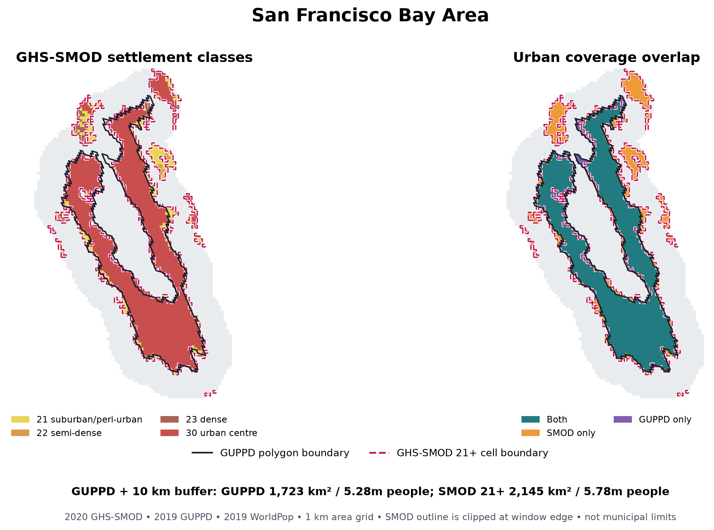
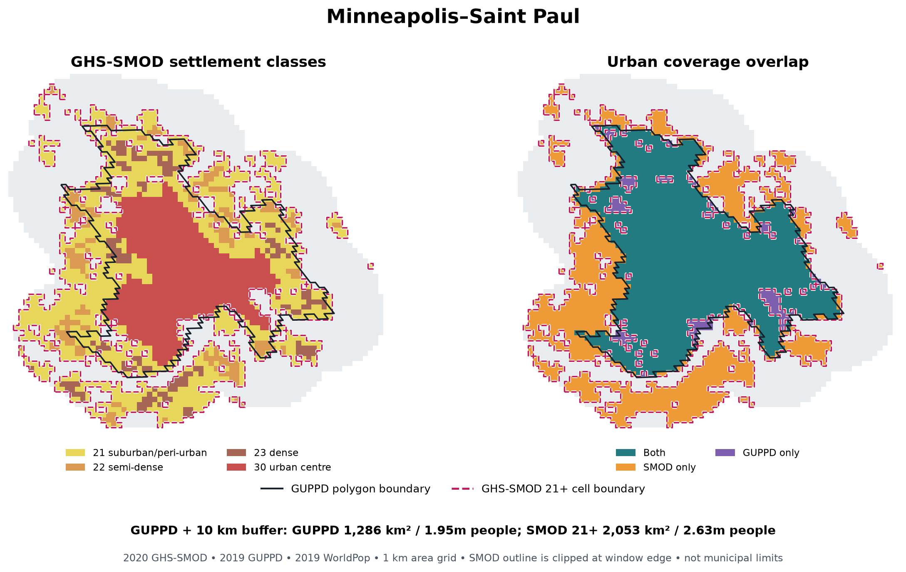

# Chiara's global_invest depression module and the GEP Global US run

**Reviewed 27 October 2026.** Code reference: NatCapTEEMs
[`global_invest_dev` at `f3059d9`](https://github.com/NatCapTEEMs/global_invest_dev/tree/f3059d901a97b35d15be2390ee7634d675b77188/global_invest/health_depression).
Chiara reported approximately **$52 billion for the US** and a **25% lower**
estimate when replacing MODIS with the shared GLC raster and Varun's lookup on
her fixed urban-cell support. These two numbers come from her email; the linked
branch contains code and method text, but not the input rasters, exact US output
row or run receipt needed to reproduce either number.

## Main comparison

| Choice | Chiara's global_invest module | GEP Global's saved US direct-NDVI run |
| --- | --- | --- |
| Geographic support | GHS-SMOD R2023A epoch 2020, codes **21, 22, 23 and 30** on a WorldPop 1 km grid; country totals. | 2019 GUPPD polygons, sampled on WorldPop's native 100 m grid; city, state and national totals. The saved $26.99 billion run includes Alaska; the active scope now excludes it, with replacement totals pending. |
| Exposure | MODIS MOD13A2 v6.1, 2019 annual-mean NDVI, exported at 30 arcsec and bilinearly warped to the population grid. The GLC/Varun lookup is an email-reported sensitivity. | Direct Landsat 7/8 2019 annual-median NDVI sampled at population cell centres. US-derived and Varun GLC-to-NDVI tables are separate sensitivity inputs. |
| Health burden | Country-specific WHO 2015 depression prevalence applied to all-age population. | Country-specific GBD 2019 all-age depressive-disorders prevalence; US saved input 4.24%. |
| OR-to-RR conversion | OR 0.931; each country's overall prevalence is used as `p0`. | Same OR; fixed `p0=0.115`, explicitly treated as a transported low-exposure risk assumption. |
| Counterfactual and cases | Positive NDVI is contrasted with zero. Observed cases × `[RR^(−10 × positive NDVI) − 1]`. | **Same current-reference equation** and zero-positive-NDVI counterfactual. Varun's original literal equation is retained as a sensitivity, not the primary result. |
| Price and uncertainty | Christensen-derived 2018 PPP-dollar input × country GDP price-level ratio × US CPI to 2019. Point estimate only in the reviewed module. | Conditional US $10,999.21/case, 2019 USD without PPP; publishes effect-OR-only 95% limits. Broader cost-scope uncertainty remains. |

The [parameter rows](https://github.com/NatCapTEEMs/global_invest_dev/blob/f3059d901a97b35d15be2390ee7634d675b77188/global_invest/input_template/es_parameters.csv#L103-L123), [pixel calculation](https://github.com/NatCapTEEMs/global_invest_dev/blob/f3059d901a97b35d15be2390ee7634d675b77188/global_invest/health_depression/health_depression_tasks.py#L42-L99), [cost conversion](https://github.com/NatCapTEEMs/global_invest_dev/blob/f3059d901a97b35d15be2390ee7634d675b77188/global_invest/health_depression/health_depression_tasks.py#L118-L150), and our [US run](us_direct_ndvi_production_run.md) are the direct code and result evidence. Chiara's shared cost year is 2018 even though her method note calls the source costs *mostly* 2018; row-specific source years should be checked before extending the conversion beyond the US. Our local copy of the corresponding 2018 PPP-labelled input has a US value of $10,803.426 and yields $10,999.21 with the documented US 2019 conversion. Chiara's exact staged US row is not in the linked Git tree, so rate equality is unverified.

**Interpreting the $52 billion gap.** Relative to our historical $26.99 billion, $52 billion is 1.93 times larger. Applying Chiara's emailed 25% exposure-test reduction to $52 billion gives about $39 billion, which remains above our historical total. That calculation shows the exposure substitution cannot by itself reconcile the two unmatched totals; it does not attribute the remaining gap. If her cost were exactly our $10,999.21 rate, $52 billion would imply about 4.73 million case equivalents versus our 2.45 million. This is conditional arithmetic, not a verified Chiara case count. The urban mask, population grid, prevalence, NDVI composite and `p0` all still differ. National prevalence is a marginal population rate, not automatically the low-exposure reference risk required for the OR-to-RR conversion; our fixed 0.115 is also a transported assumption.

## Two-city urban-coverage demonstration

The figures compare one **level-30 GUPPD urban region** for each named city with GHS-SMOD codes 21+ inside that polygon and nearby. GHS-SMOD is a national raster mask, so it has no polygon corresponding exactly to a named GUPPD city. We used the polygon **plus a 10 km buffer as a local comparison window** to display nearby included cells without counting distant urban areas. Ten kilometres is a pragmatic, arbitrary window: SMOD-only area and population totals depend on it, and the blue SMOD outline is clipped at its edge. Neither Chiara’s national model nor our GUPPD model uses this buffer as an urban definition. The San Francisco feature covers the wider Bay Area, and the Minneapolis feature includes Saint Paul; neither is a municipal boundary. The within-GUPPD overlap is less sensitive to the window than the added-area totals. This example is not a city-level allocation or a national extrapolation.

| Region | GUPPD area | SMOD 21+ area | Area added net | GUPPD population | SMOD 21+ population | Population added net |
| --- | ---: | ---: | ---: | ---: | ---: | ---: |
| San Francisco Bay Area | 1,723 km² | 2,145 km² | **+24.5%** | 5.28 million | 5.78 million | **+9.5%** |
| Minneapolis–Saint Paul | 1,286 km² | 2,053 km² | **+59.6%** | 1.95 million | 2.63 million | **+34.7%** |

Most GUPPD population is also in SMOD 21+: **99.4%** in the Bay Area region and **98.5%** in Minneapolis–Saint Paul on the common WorldPop population grid. The extra SMOD-only areas contain about **0.53 million** and **0.71 million** people, respectively; GUPPD-only areas contain about 0.03 million in each. These are support differences, not predicted depression cases. The mapped SMOD-only areas include suburban/peri-urban cells and, in the Bay Area buffer, some separate urban-centre cells.

Both maps draw the **GUPPD polygon in solid black** and the **GHS-SMOD 21+ raster-cell boundary in dashed magenta with a thin white halo**. The latter is clipped at the buffer edge.

### Measurement and reproduction

- **Source:** JRC [GHS-SMOD R2023A, epoch 2020](https://human-settlement.emergency.copernicus.eu/ghs_smod2023.php), Earth Engine image `JRC/GHSL/P2023A/GHS_SMOD_V2-0/2020`, band `smod_code`. The [official class legend](https://developers.google.com/earth-engine/datasets/catalog/JRC_GHSL_P2023A_GHS_SMOD_V2-0) defines 21, 22, 23 and 30. Crops are downloaded at 1 km into ignored `data/raw/ghs_smod/2020_two_city_crops/`.
- **GUPPD:** `data/processed/guppd_us_contiguous.gpkg`, IDs `30_12257` and `30_12427`. Polygon area and SMOD overlap are measured on the same EPSG:5070 1 km grid using cell-centre membership. Raster-grid areas, not exact vector areas, appear in the table.
- **Population:** `data/raw/worldpop/usa_pop_2019_CN_100m_R2025A_v1.tif`. Both masks are evaluated on this **same** 100 m population grid; SMOD classes are transferred by nearest-neighbour resampling. This controls population-source differences for the demonstration but does **not** reproduce Chiara's aggregated 1 km population raster, country rasterization or exact grid alignment.
- **Reproduce:** In an environment with `earthengine-api`, `geopandas`, `rasterio` and `matplotlib`, run `python scripts/03_checks/compare_smod_guppd_cities.py` from the repository root. The script downloads missing crops, calculates both supports and rebuilds the maps. The [machine-readable summary](data/smod_guppd_two_city_summary.json) records source IDs, input checksums, exact counts and output paths.

**Next test:** Recompute the US urban-population overlap on Chiara's actual WorldPop 1 km grid and compare cases per person on identical valid NDVI cells. Then change the mask, NDVI, prevalence, `p0` and cost separately. The two-city example establishes that the mask choice can materially change who is included; it does not quantify how much of the $52 billion national difference it explains.
