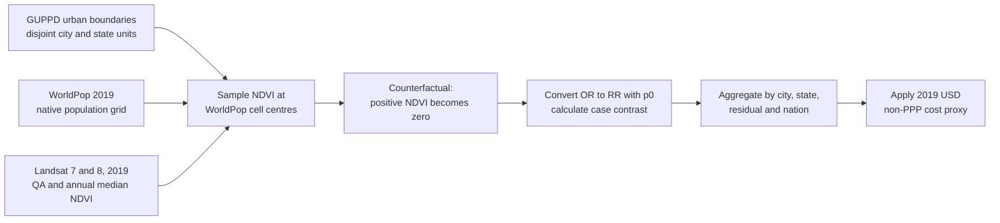

# 2019 US urban mental health direct-NDVI production run

Completed 2026-10-17. Status: **nationwide calculation complete; internal checks passed**. A small cross-engine boundary-cell difference is reported below.

## Key results

> **Removing all positive NDVI in the model increases depressive-disorder burden by an estimated 2.45 million case equivalents, with conditional 95% effect-size limits of 0.71 million–4.63 million. The associated societal-value proxy is $26.99 billion in 2019 USD, without PPP.**

| Quantity | Reported result |
| --- | ---: |
| GUPPD urban features | 3,312 |
| Population in scope | 194.37 million |
| Population with valid NDVI | 194.37 million (99.999%) |
| Population without valid NDVI | 2.62 thousand (0.001%) |
| Baseline depressive-disorder case equivalents on modelled population | 8.25 million |
| **Additional case equivalents** | **2.45 million** |
| Conditional 95% effect-size limits | **0.71 million–4.63 million** |
| **2019 USD societal-value proxy** | **$26.99 billion** |
| Conditional value limits | **$7.86 billion–$50.89 billion** |

These are counterfactual model outputs rather than observed cases, forecasts, treatment expenditures or cash savings.

## Workflow at a glance

1. Retain 3,312 GUPPD urban polygons in 49 states plus DC; include Alaska and exclude Hawaii and territories. Remove polygon overlap once and split cross-state features into disjoint reporting units.
2. Build the 2019 annual median from valid Landsat 7/8 Collection 2 Level 2 NDVI observations. Require at least three valid observations and sample the nearest 30 m value at each native WorldPop cell centre.
3. Set positive NDVI to zero for the counterfactual. Nonpositive NDVI has no exposure difference.
4. Convert the published OR to an RR using `RR = OR / (1 − p0 + p0 × OR)`. Calculate `prevalence-derived 2019 case equivalents × [RR^(−10 × positive NDVI) − 1]` and aggregate without rounding intermediate values.
5. Multiply case equivalents by the US cost proxy and report the result in 2019 USD without PPP.

Inputs used here are US 2019 all-age depressive-disorders prevalence **4.24%**, `p0 = 11.5%`, and OR **0.931** (95% CI **0.887–0.977**) per +0.1 NDVI. The exact unrounded inputs remain in the machine-readable outputs.

## Difference from Varun Sethi's original implementation

The comparison below refers to the original Observarun [`run_urban_mental_health.py`](https://github.com/Observarun/urban-mental-health-gep/blob/f1822e2/run_urban_mental_health.py) and [`urban_mental_health_functions.py`](https://github.com/Observarun/urban-mental-health-gep/blob/f1822e2/urban_mental_health_functions.py) at commit [`f1822e2`](https://github.com/Observarun/urban-mental-health-gep/tree/f1822e2). It compares implementation and estimand; the original repository does not contain a completed national output to reproduce numerically.

| Component | Original Observarun implementation | Current production run |
| --- | --- | --- |
| Execution and scope | Local Python/Hazelbean global-raster pipeline with user-supplied inputs and fixed machine paths. | Versioned Earth Engine run for the reviewed US subset; 133 resumable batches with explicit task receipts. |
| Nature exposure | Warp GLC_FCS30D land cover to WorldPop with nearest-neighbour resampling, then assign one NDVI value to each land-cover class from a lookup table. | Use the 2019 Landsat annual-median NDVI pixels directly; no land-cover class-to-NDVI lookup enters the production exposure. |
| Counterfactual | Set every positive lookup-derived NDVI value to zero. | Same conceptual counterfactual, applied to direct Landsat NDVI sampled on the population grid. |
| Health contrast | `prevalence × population × [1 − RR^(10 × ΔNDVI)]`, labelled preventable cases. This applies the risk-reduction fraction to prevalence-derived baseline cases. | `2019 reference case equivalents × [RR^(−10 × ΔNDVI) − 1]`, reported as additional case equivalents if current nature were removed. This explicitly uses the prevalence-derived 2019 state as the reference. |
| Prevalence | Fixed `0.05` for every country. | Country-specific 2019 GBD prevalence; **4.24%** for this US run, aligned with the all-age WorldPop denominator. |
| `p0` and OR-to-RR | Fixed `p0 = 0.115`; convert the depression OR to an RR. | Retains the conversion but labels `p0 = 0.115` as a transported assumption and records sensitivity work. |
| Uncertainty | Uses only the point effect estimate. | Reports conditional 95% limits from the effect estimate; other uncertainty remains outside the interval. |
| Spatial aggregation | Zonal statistics over the original urban polygons; region totals are rounded before country aggregation. Polygon overlap is not explicitly allocated once. | Uses disjoint city/state units, retains fractional cases through aggregation, reports missing NDVI support, and reconciles state/DC plus residual totals. |
| Valuation | Multiplies country cases by the supplied `cost_per_case`; the code does not enforce currency year or PPP status. | Uses an explicitly labelled US proxy of about **$11,000 per case equivalent**, reported in **2019 USD without PPP**. |
| Reproducibility | Skips existing intermediates but does not create a run manifest or input/output hashes. | Pins code and graph hashes, preserves task IDs, validates unique receipts, publishes row-level summaries and supplies SHA-256 checksums. |

Both implementations retain the same central idea: compare current urban nature with a zero-positive-NDVI counterfactual, convert an odds ratio using `p0`, calculate a population-weighted depression contrast, and aggregate it geographically. The production result should therefore be described as an extension and clarification of the original model, rather than a literal rerun of Varun's code.

## Largest state contributions

| State | Modelled population | Additional case equivalents | 2019 USD proxy |
| --- | ---: | ---: | ---: |
| CA | 35.85 million | 289.74 thousand | $3.19 billion |
| TX | 17.76 million | 232.00 thousand | $2.55 billion |
| FL | 15.47 million | 217.03 thousand | $2.39 billion |
| NY | 14.95 million | 157.02 thousand | $1.73 billion |
| IL | 9.93 million | 139.20 thousand | $1.53 billion |
| OH | 6.10 million | 101.52 thousand | $1.12 billion |
| MI | 5.57 million | 97.19 thousand | $1.07 billion |
| NJ | 6.95 million | 89.45 thousand | $983.83 million |
| PA | 6.30 million | 82.05 thousand | $902.49 million |
| VA | 4.46 million | 72.55 thousand | $797.96 million |

These rows cover only the GUPPD urban areas intersecting each state and are not whole-state burden estimates.

## Method sensitivity

The earlier five-region pooled land-cover lookup produced 2.52 million case equivalents. The direct-NDVI result is -2.74% different. This is a method sensitivity comparison, not an uncertainty interval; the pooled lookup was rejected for production because it transferred poorly among test cities.

The four-city gate reproduced the earlier direct-grid estimates exactly for Portland and within **0.01%** for Anchorage, Tucson and New York. The remaining differences match previously identified boundary-cell membership differences.

## Verification and reproducibility

- All 133 Earth Engine table batches completed.
- Exactly 3,312 unique expected city receipts were recovered; no city was duplicated or omitted.
- The 50 state/DC summaries plus the boundary residual (7.01 thousand people; 87.4 case equivalents) reconcile to the national totals.
- Population support, interval order, observed-case arithmetic and valuation arithmetic passed at national, state and city levels.
- Model source commit: `66e9c165700eba391fdfef8857856840a803bb8e`; model graph SHA-256: `1df0d08b896c29c0a1bbef8d3c71656f6322acdf40ce27de449405cf0223ac98`.
- Machine-readable outputs: [national summary](data/us_direct_ndvi_2019_v1/national_summary.json), [state summary](data/us_direct_ndvi_2019_v1/state_summary.csv), [city summary](data/us_direct_ndvi_2019_v1/city_summary.csv), [city-state rows](data/us_direct_ndvi_2019_v1/city_state_rows.csv), [task manifest](data/us_direct_ndvi_2019_v1/direct_ndvi_batch_manifest.json), and [checksums](data/us_direct_ndvi_2019_v1/checksums.sha256).

The Earth Engine reporting geometry contains 194.37 million people, 6.19 thousand (0.003%) more than the independent local native-cell-centre audit. The difference is distributed across 1,456 feature totals and reflects the known cross-engine boundary-cell membership sensitivity. The reported production values retain the reviewed Earth Engine reporting units and are not rescaled to the local population total.

## Interpretation limits

The 95% limits propagate only the published effect-size interval. They hold `p0`, prevalence, population, NDVI, geographic membership and cost fixed. The exposure-response estimate and `p0` are transported assumptions; the all-age GBD prevalence matches the all-age population denominator but is not an adult current-MDD endpoint. GUPPD features represent physical urban extents rather than municipal boundaries. The cost factor is broader than depression treatment cost, so the dollar result is an exploratory societal-value proxy. A later Monte Carlo analysis should jointly vary the effect, `p0`, prevalence, exposure and cost inputs.
